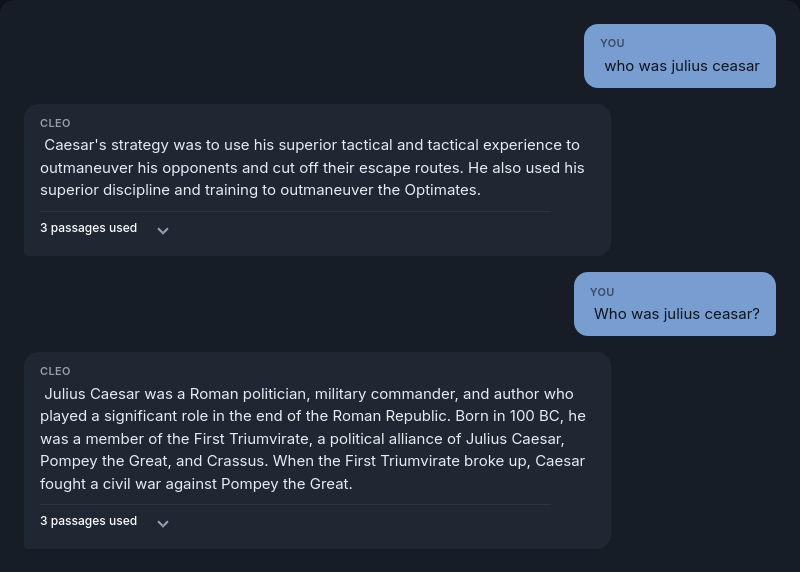

Most AI assistants run on big servers somewhere else. Cleo runs the model on
the visitor's own computer instead, inside the browser tab.

Cleo is an assistant for Simple English Wikipedia, live at
[cleo.gearsandtrees.com](https://cleo.gearsandtrees.com/). The language model
runs on your own laptop or phone. A search on a server finds the Wikipedia
passages it answers from. She is named after Cleopatra, so I test her with
questions about Julius Caesar.

Running the model in the browser raises different questions than running it on
a server. These are the three I ran into, in the order I ran into them.

## How big a model fits?

Every visitor downloads the model, and it has to fit in the memory of their
laptop or phone. It also has to answer in time, because every word is computed
on the visitor's own hardware. So only a small model will do.

The first plan was SmolLM2-135M. Cleo ended up with SmolLM2-360M, because a
shrunken 360M model is smaller than the 135M one:

| Model        | Stored as     | Download     |
| ------------ | ------------- | ------------ |
| SmolLM2-360M | 32-bit floats | 1.44 GB      |
| SmolLM2-360M | 16-bit floats | 720 MB       |
| SmolLM2-360M | 8 bits        | about 380 MB |
| SmolLM2-360M | 4 bits        | about 230 MB |
| SmolLM2-135M | 16 bits       | about 270 MB |

Shrinking a model like this is called quantization. A model is mostly a long
list of numbers, its weights, and most of them are small, well within ±1. Stored
as plain whole numbers they would all round to −1, 0 or 1. So quantization
stores one extra number, a scale, that stretches the largest weight to the end
of the integer range.

At 4 bits there are 15 whole numbers, −7 to 7. The weight farthest from zero
lands on 7, and every other weight is rounded to the nearest step.

```text
step      = largest |weight| / 7
stored as = round(weight / step)
```

### One outlier ruins it for everyone

The largest weight sets the scale. One weight far larger than the rest makes the
steps wide enough to hold it, and all the ordinary weights end up on the few
steps nearest zero.

You can clip it. The range stops short of the outlier, and the outlier is stored
as the end of the range. The ordinary weights get their steps back, and the
outlier comes back wrong. Whether that pays off depends on how rare the outliers
are. A real layer has thousands of ordinary weights per outlier.

### Blocks

The other way out is to give each block of 32 neighbouring weights its own
scale. An outlier then only widens the steps of its own block. A block is 32
weights of 4 bits plus one 16-bit scale, so 144 bits, or 4.5 bits per weight.
That is what the Q4_0 in a model's file name means.

A scale centred on zero also wastes steps when the weights are mostly positive.
Q4_1 stores each block's smallest weight as well, so the range runs from the
smallest weight to the largest. On an example matrix at 4 bits:

|                         | Centred on zero               | Smallest to largest           |
| ----------------------- | ----------------------------- | ----------------------------- |
| One scale for all       | 0.0154 error, 4.01 bits       | 0.0131 error, 4.02 bits       |
| A scale per block of 32 | 0.0051 error, 4.5 bits (Q4_0) | 0.0038 error, 5.0 bits (Q4_1) |

Blocks do most of the work. The minimum takes off a little more, for half a bit
more per weight. Cleo's files are built like Q4_0: 4-bit weights in blocks of
32, one scale per block.

[Quant Lens](https://learn.gearsandtrees.com/quant-lens/) shows all of this with
examples you can drag around, one idea per step.

### The visitor's hardware picks the file

On a server you choose the GPU once. In the browser every visitor brings their
own. Cleo checks before downloading anything:

- No WebGPU: q4 on the CPU, with WebAssembly.
- WebGPU, but no 16-bit floats on the GPU: q4 on the GPU.
- WebGPU with 16-bit floats: q4f16 on the GPU.

Before the CPU fallback, the chat was dead on Firefox and older Safari, and the
only advice Cleo gave those visitors was to reload the page. That could never
help.

## How do you get good answers from a small model?

A model writes one token at a time. A token is a word or a piece of one. Cleo
always takes the most likely next token, which is called greedy decoding, so
the same prompt gives the same answer every time.

So the question is what the most likely continuation is. With a model this
small, very often it is text that is already in the prompt.



Misspelled, and without a question mark, Cleo answered with his battle tactics.
Under the passages, "who was julius ceasar" reads as an unfinished sentence, so
the model carried on with the text. Cleo now adds the missing question mark
before the model sees it.

Two more of the same:

- The prompt said "question" twice. Cleo answered that Alan Turing "is the
  subject of the question". The word is out of the prompt now.
- "Do not answer with more than 3 sentences" was not followed. "Answer with only
  2 sentences" worked better. Say what you want, not what to avoid.

One fix made it worse. To stop Cleo writing about the question, I tried starting
her answer for her with the subject's name. Asked "Why do volcanoes erupt?", she
answered "Earth science" and nothing else. There was no name in that question,
so the subject fell back to the title of the top passage, and a noun on its own
is a complete reply. I reverted it three minutes later.

### Why there is no repetition penalty

The usual fix for a model that repeats itself is a repetition penalty. It lowers
the score of every token that is already in the input. Here the input includes
the passages the answer should come from, so the penalty would push Cleo away
from quoting them. Asked whether Julius Caesar was married, it would push
Calpurnia down. That is one way to rewrite history.

So there is no penalty, and the answer stops after three sentences instead.

### Follow-ups kept getting the same answer

A follow-up such as "what did he conquer" needs to know who "he" is. I tried
telling the model inside the prompt, three times:

1. A running summary of the chat, before the question. The model copied the
   summary.
2. Key terms and a "Topic:" line. The follow-up found the same passages, and
   gave the same answer.
3. The last question and answer as real chat turns. The model handed the
   previous answer back.

Each time the prompt held a copy of the previous answer, next to much the same
passages. For a greedy model, the likeliest continuation was that answer again.

Now nothing from the previous exchange goes into the prompt. Ordinary code
rewrites a follow-up so that it names its subject, before the search or the
model sees it.

| You type            | Cleo uses                      |
| ------------------- | ------------------------------ |
| is he married       | is Julius Caesar married       |
| who was his wife    | who was Julius Caesar's wife   |
| what did he conquer | what did Julius Caesar conquer |

Code like this is predictable and has tests. It has limits too. After "who was
his wife", "how old was she" becomes "how old was Julius Caesar". You ask about
his wife, and you get more Julius.

## Where do its facts come from?

Cleo has Simple English Wikipedia as 423,627 passages of about 250 tokens. Each
passage is stored as an embedding, 384 numbers that describe what the text is
about. Texts about the same thing get similar numbers, so the search finds
passages by meaning rather than by matching words.

Postgres with pgvector finds the passages nearest to the question. If the
nearest one is at least 0.4 similar, the top three go to the model. If not,
Cleo says she does not know, and the model is not called.

The nearest passage is not always a relevant one. Asked whether Julius Caesar
was married, the search found the page about his father, who had the same name.
That page says "Caesar was married to Aurelia Cotta". Aurelia Cotta was Julius
Caesar's mother. Search by meaning finds a Caesar, not this Caesar, and the
threshold does not help. It stops questions that match nothing, not questions
that match too much.

## Is it still local?

Partly.

| Step                     | Runs on    | Leaves the device |
| ------------------------ | ---------- | ----------------- |
| Turning speech into text | the device | nothing           |
| Rewriting a follow-up    | the device | nothing           |
| Finding passages         | the server | the question      |
| Writing the answer       | the device | nothing           |

The model is local. The search is not: the server sees every question.

That is deliberate. Searching in the browser would mean every visitor downloads
a 2 GB database first, and again after every update. The vectors alone are
about 650 MB, nearly three times the model. The model fits in the browser.
Wikipedia does not.

Both are online. Try [Quant Lens](https://learn.gearsandtrees.com/quant-lens/)
on your phone. [Cleo](https://cleo.gearsandtrees.com/) is better on a laptop,
and downloads her model once, about 230 MB.
